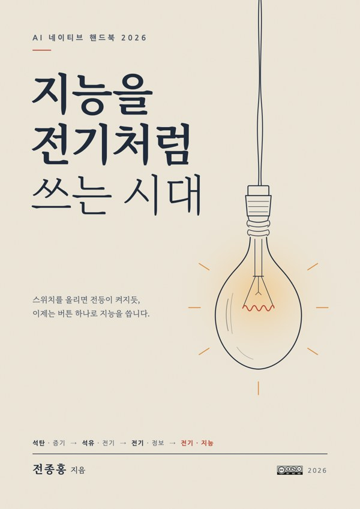

# 지능을 전기처럼 쓰는 시대 — AI 네이티브 핸드북 2026

전종홍 지음 · 2026

> 이 책은 **CC BY-NC-ND 4.0**(저작자표시-비영리-변경금지) 조건으로 공개합니다. 저자를 밝히고 비영리 목적으로만, 내용을 바꾸지 않고 나눌 수 있습니다. 자세한 내용은 아래 [이용 허락](#이용-허락)을 보세요.

석탄이 증기를, 석유가 전기를 불러왔듯 이제 전기는 지능이 됩니다. 이 책은 파운데이션 모델을 발전소로, MCP·A2A를 송전망으로, AI 에이전트를 가전제품으로 보는 하나의 비유로 AI 네이티브 시대를 풀어 씁니다. 회사와 나라가 배치도를 어떻게 다시 그려야 하는지 차근차근 이야기합니다.

## 내려받기

| 형식 | 링크 |
|---|---|
| PDF (407쪽, 인쇄용 판형) | [ai-native-handbook-2026.pdf](https://github.com/hollobit/ai-native/releases/latest/download/ai-native-handbook-2026.pdf) |
| EPUB (전자책 단말기·앱) | [ai-native-handbook-2026.epub](https://github.com/hollobit/ai-native/releases/latest/download/ai-native-handbook-2026.epub) |

위 링크는 항상 최신판을 가리킵니다. 지난 판은 [Releases](https://github.com/hollobit/ai-native/releases)에서 볼 수 있습니다. 책 뒤표지와 판권면의 QR 코드도 같은 PDF 주소로 연결됩니다.

## 이용 허락

이 책은 [크리에이티브 커먼즈 저작자표시-비영리-변경금지 4.0 국제 라이선스(CC BY-NC-ND 4.0)](https://creativecommons.org/licenses/by-nc-nd/4.0/deed.ko)를 따릅니다. 저자를 밝히면 비영리 목적으로 자유롭게 복제·배포할 수 있지만, 내용을 고치거나 2차 저작물을 만들 수는 없습니다. 본문의 도표·삽화·표지도 같은 조건이며, 인용한 자료의 저작권은 각 원저작자에게 있습니다.

| 조건 | 뜻 |
|---|---|
| 저작자표시 (BY) | 저자(전종홍)와 출처를 밝혀야 합니다. |
| 비영리 (NC) | 영리 목적으로 이용할 수 없습니다. |
| 변경금지 (ND) | 내용을 고치거나 번역·발췌 편집 등 2차 저작물을 만들어 배포할 수 없습니다. |

라이선스 전문(영문)은 [LICENSE](LICENSE) 파일에 있습니다. 상업적 이용이나 2차 저작물 제작은 저자에게 따로 문의해 주세요.
